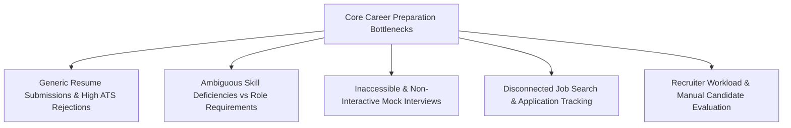
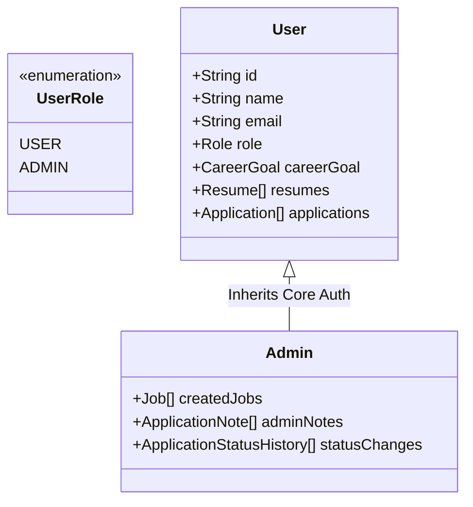
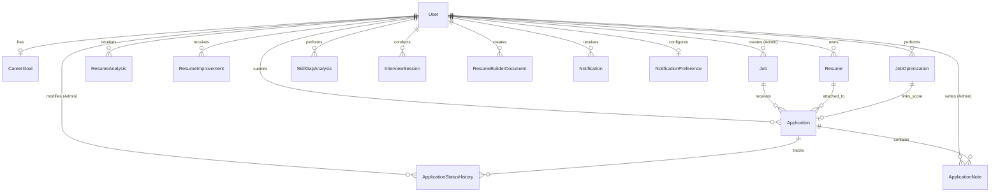
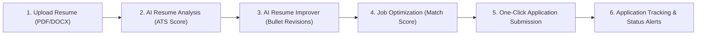
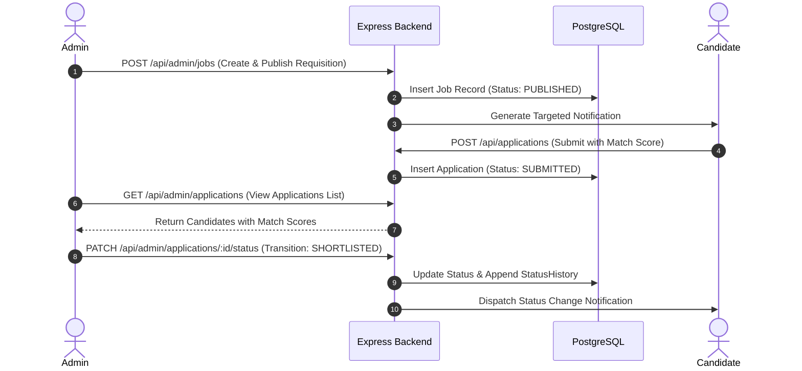

# ElevAI — AI-Powered Smart Interview & Career Preparation Portal

---

# 1. COVER PAGE

```text
====================================================================================================
                                      PROJECT REPORT ON

                                           ElevAI
                 AI-POWERED SMART INTERVIEW & CAREER PREPARATION PORTAL

                                  Academic Year: 2026–2027

          Submitted in partial fulfillment of the requirements for the award of the degree of
                               BACHELOR OF COMPUTER APPLICATIONS (BCA)

====================================================================================================

SUBMITTED BY:
  Student Name        : [STUDENT NAME PLACEHOLDER]
  Enrollment / Roll No: [ROLL NUMBER PLACEHOLDER]
  Course / Semester   : BCA — Final Year (VI Semester)

UNDER THE GUIDANCE OF:
  Project Guide / HOD : [PROJECT GUIDE / FACULTY NAME PLACEHOLDER]
  Designation         : [FACULTY DESIGNATION PLACEHOLDER]

DEPARTMENT & INSTITUTION:
  Department          : Department of Computer Applications / Information Technology
  Institution / College: [COLLEGE / UNIVERSITY NAME PLACEHOLDER]
  Affiliated To       : [UNIVERSITY NAME PLACEHOLDER]
  Submission Date     : [SUBMISSION DATE PLACEHOLDER]
====================================================================================================
```

---

# 2. CERTIFICATE

```text
                                      DEPARTMENT OF COMPUTER APPLICATIONS
                                  [COLLEGE / UNIVERSITY NAME PLACEHOLDER]
                                      [COLLEGE ADDRESS PLACEHOLDER]

                                                CERTIFICATE

This is to certify that the project entitled:

        "ElevAI — AI-Powered Smart Interview & Career Preparation Portal"

is a bona fide record of independent project work carried out by:

        Student Name        : [STUDENT NAME PLACEHOLDER]
        Enrollment / Roll No: [ROLL NUMBER PLACEHOLDER]

in partial fulfillment of the requirements for the award of the Degree of BACHELOR OF COMPUTER APPLICATIONS (BCA) during the academic year 2026–2027.

The project work has been audited, reviewed, and approved as meeting the academic standards required for the degree.


___________________________                                       ___________________________
Internal Guide / Faculty                                          Head of the Department (HOD)
[Guide Name Placeholder]                                          [HOD Name Placeholder]
Department of Computer Applications                               Department of Computer Applications


___________________________                                       ___________________________
External Examiner                                                 Principal / Dean
Date: [Date Placeholder]                                          [College Seal Placeholder]
```

---

# 3. DECLARATION

```text
                                                DECLARATION

I, [STUDENT NAME PLACEHOLDER], hereby declare that the project entitled:

        "ElevAI — AI-Powered Smart Interview & Career Preparation Portal"

submitted to the Department of Computer Applications, [COLLEGE / UNIVERSITY NAME PLACEHOLDER], in partial fulfillment of the requirements for the award of the Degree of Bachelor of Computer Applications (BCA), is an authentic record of original project work carried out by me under the supervision and guidance of [PROJECT GUIDE NAME PLACEHOLDER].

I further declare that this project report, in whole or in part, has not been previously submitted to any other university, institute, or examination board for the award of any degree, diploma, fellowship, or other similar title or recognition.


Place: [Location Placeholder]
Date : [Date Placeholder]

                                                                ___________________________
                                                                [STUDENT NAME PLACEHOLDER]
                                                                Roll No: [ROLL NUMBER PLACEHOLDER]
```

---

# 4. ACKNOWLEDGEMENT

I express my deepest gratitude to all the individuals who supported and guided me through the design, implementation, and verification of **ElevAI — AI-Powered Smart Interview & Career Preparation Portal**.

First and foremost, I express my sincere thanks to my project guide, **[PROJECT GUIDE / FACULTY NAME PLACEHOLDER]**, for their invaluable guidance, constructive criticism, and technical suggestions throughout the development lifecycle of this project.

I am immensely grateful to **[HEAD OF DEPARTMENT NAME PLACEHOLDER]**, Head of the Department of Computer Applications, and **[PRINCIPAL / DEAN NAME PLACEHOLDER]**, Principal of **[COLLEGE / UNIVERSITY NAME PLACEHOLDER]**, for providing the computational infrastructure, laboratory facilities, and an encouraging academic environment.

I also extend my sincere appreciation to all faculty members of the Department of Computer Applications for their continuous academic support, as well as to my peers and family for their unwavering encouragement during the completion of this project.

---

# 5. ABSTRACT

In the contemporary job market, aspiring job seekers and graduating students face significant obstacles bridging the gap between academic preparation and industry expectations. Traditional career preparation methods are fragmented: resume editing is manual, feedback on applicant-tracking-system (ATS) compatibility is generic, mock interview practice is cost-prohibitive, and job discovery lacks personalized fit analysis.

**ElevAI** is an intelligent, full-stack web portal designed to address these challenges through a unified career intelligence and recruitment platform. Built on **React.js**, **Tailwind CSS**, **Node.js/Express.js**, **Prisma ORM**, **Supabase PostgreSQL**, **Supabase Storage**, and **Google Gemini Generative AI**, ElevAI delivers end-to-end career enablement. 

Key capabilities include:
1. **AI Resume Analyzer & Improver**: Extracts raw text from multi-format resumes (PDF/DOCX), evaluates structural clarity, and generates quantifiable, action-oriented bullet revisions while preserving original user text.
2. **Job-Specific Resume Optimization**: Computes mathematical match scores against real job descriptions, isolating matching and missing competencies.
3. **Skill Gap Analysis & Roadmapping**: Synthesizes structured role expectations and prioritized learning action items.
4. **AI Mock Interview Simulator**: Dynamically conducts behavioral and technical interview sessions with automated feedback across technical relevance and communication clarity.
5. **Interactive Resume Builder**: Offers drag-and-drop section management, live ATS rendering, and single-click export into the user's active resume vault.
6. **Full-Cycle Recruitment Portal & Analytics Engine**: Enables administrators to create requisitions (Draft $\to$ Published $\to$ Closed), broadcast targeted notifications, inspect candidate review dossiers, track status transitions (`SUBMITTED` $\to$ `SELECTED`), and compute real-time recruitment metrics directly from PostgreSQL.

ElevAI incorporates resilient offline heuristic engines ensuring 100% operational uptime during upstream AI quota spikes, role-based access control (RBAC), parameter validation, and secure signed storage URLs, delivering a production-ready system.

---

# 6. INTRODUCTION

### 6.1 Background
The digital transformation of talent acquisition has automated candidate screening. Modern organizations rely on automated Applicant Tracking Systems (ATS) and machine learning parsers to filter resumes before human recruiters review them. Consequently, candidates submitting generic resumes face rejection rates exceeding 70%, often without feedback explaining why their application was dismissed.

### 6.2 The Career Preparation Gap
Job seekers encounter several interconnected friction points:
* **Resume Misalignment**: Resumes lack industry-standard action verbs, quantifiable metrics, and targeted technical keywords.
* **Skill Opaque Requirements**: Job requisitions outline broad requirements, leaving candidates uncertain about which specific technologies they lack.
* **Interview Anxiety**: Traditional mock interview coaching is expensive and inaccessible to most students.
* **Disjointed Tools**: Candidates are forced to use disparate tools for resume writing, skill assessment, interview practice, and job searching.

### 6.3 Purpose & Target Audience
ElevAI consolidates career preparation and recruitment into one unified ecosystem. It serves two distinct audiences:
1. **Candidates (Students & Job Seekers)**: Receive structured resume evaluations, job fit optimizations, interview practice, and direct job application tracking.
2. **Administrators (Recruiters & Placement Cells)**: Post requisitions, review candidate applications with score snapshots, record private recruiter notes, manage status progression, and monitor recruitment telemetry.

---

# 7. PROBLEM STATEMENT

ElevAI directly addresses the following operational problems:



1. **Generic Resume Submissions**: Candidates submit static resumes across diverse job roles, failing ATS keyword matching and formatting standards.
2. **Ambiguous Skill Gaps**: Candidates lack automated tools to compare their existing credentials against target job descriptions.
3. **High-Cost Mock Interviews**: Meaningful interview practice with instant feedback on communication and technical depth is unavailable at scale.
4. **Recruitment Silos**: Employers and college placement cells struggle to filter applicants systematically by factual skill match, manage candidate dossiers, and broadcast instant updates.

---

# 8. OBJECTIVES

The technical and operational objectives of ElevAI are:

* **Objective 1**: Develop a secure, responsive single-page web application (SPA) using React.js and Tailwind CSS with a futuristic, cyber-themed design language.
* **Objective 2**: Implement a modular Node.js/Express.js RESTful API architecture with Prisma ORM connected to Supabase PostgreSQL.
* **Objective 3**: Build an AI Resume Analyzer that parses multi-format resumes and outputs multi-dimensional ATS scores (0–100) with detailed section breakdowns.
* **Objective 4**: Build an AI Resume Improver that generates quantifiable revisions while strictly preserving original candidate data.
* **Objective 5**: Provide Job-Specific Resume Optimization that computes real-time match scores against active job requisitions.
* **Objective 6**: Deliver an interactive AI Mock Interview Simulator supporting technical, behavioral, and mixed interview sessions with question-by-question scoring.
* **Objective 7**: Implement an Interactive Resume Builder with template switching, section reordering, versioning, and single-click export to vault.
* **Objective 8**: Implement an Admin Recruitment Management Panel supporting job lifecycle states (Draft, Published, Closed), application deadlines, and candidate review dossiers.
* **Objective 9**: Provide a Recruitment Analytics Engine calculating continuous daily submission trends, skill demand distributions, and deadline urgency alerts from live database records.
* **Objective 10**: Enforce strict server-side Role-Based Access Control (RBAC), multi-tenant data isolation, RFC 4122 UUID parameter validation, and private signed storage downloads.

---

# 9. SCOPE OF THE PROJECT

### 9.1 Implemented In-Scope Capabilities
* **Candidate Scope**: User registration, login, profile setup, career goal configuration, resume upload/parsing, AI analysis, AI improvement, job optimization, skill gap analysis, mock interview simulator, salary estimation, interactive resume builder, job search/filter, job application submission, application status tracking, and notification management.
* **Administrator Scope**: Administrative authentication, dashboard telemetry, job requisition management (Create, Edit, Publish, Close, Delete Drafts), candidate application review dossier, private recruiter notes management, status pipeline updates (`SUBMITTED` $\to$ `UNDER_REVIEW` $\to$ `SHORTLISTED` $\to$ `INTERVIEW` $\to$ `SELECTED` / `REJECTED`), status history audit logging, and recruitment analytics.
* **AI & Fallback Scope**: Gemini API integration with prompt construction, structured JSON validation, and dual-layer offline heuristic calculation fallback engines.

### 9.2 Out-of-Scope (Future Enhancements)
* Live peer-to-peer WebRTC video streaming between candidates and human interviewers.
* Payment gateway integrations for premium recruiter subscriptions.
* Native mobile applications (iOS/Android) — mobile view is supported via responsive web design.

---

# 10. EXISTING SYSTEM VS 11. PROPOSED SYSTEM

| Parameter | Traditional / Existing Systems | ElevAI Proposed System |
| :--- | :--- | :--- |
| **Resume Review** | Manual human review or static keyword counters. | Deep semantic analysis using Google Gemini AI and ATS scoring heuristics. |
| **Resume Editing** | Manual word processing without contextual feedback. | AI Resume Improver generates metric-driven bullet points while preserving original text. |
| **Job Compatibility** | Manual reading of lengthy job descriptions. | Automated Job Optimization computing match scores and missing competencies. |
| **Interview Preparation** | Static interview question lists or expensive human coaches. | Dynamic AI Mock Interview Simulator evaluating answers in real time. |
| **Job Application Flow** | Third-party job boards disconnected from resume tools. | Unified portal: Prepare $\to$ Analyze $\to$ Optimize $\to$ Apply in one click. |
| **Recruiter Review** | Spreadsheets and unorganized email inboxes. | Centralized Admin Review Dossier with status transition audit trails and private notes. |
| **Recruitment Telemetry** | Manually compiled monthly reports. | Live PostgreSQL analytics engine generating continuous time-series charts and skill demands. |
| **System Resilience** | Fails entirely when external AI APIs encounter rate limits. | Built-in offline fallback calculation engines ensuring 100% feature availability. |

---

# 12. SYSTEM USERS AND ROLES (RBAC)

ElevAI enforces two distinct system roles defined in the PostgreSQL database:



1. **USER (Candidate / Student)**:
   * Access to personal candidate dashboard, career goals, resume vault, and AI tools.
   * Allowed to browse published jobs, analyze resume fit, submit applications, and track application status.
   * **Restricted from**: Accessing `/admin` routes, modifying job requisitions, reviewing other candidates, or viewing internal recruiter notes.
2. **ADMIN (Recruiter / Placement Officer)**:
   * Access to the Admin Control Panel (`/admin`), overview telemetry, and job management suite.
   * Allowed to create draft requisitions, publish jobs, review candidate dossiers, add private notes, transition application statuses, and inspect recruitment analytics.
   * Enforced on the server via `requireAdmin` middleware checking cryptographically signed JWT payloads.

---

# 13. SYSTEM ARCHITECTURE

ElevAI utilizes a modern **Three-Tier Decoupled Client-Server Architecture**:

```mermaid
graph TB
    subgraph "Client Layer (Frontend)"
        ReactApp["React 18 Single Page Application"]
        Tailwind["Tailwind CSS UI (Cyber Glassmorphic Theme)"]
        Router["React Router DOM v7 (SPA Navigation)"]
        AxiosClient["Axios HTTP Client with JWT Interceptors"]
    end

    subgraph "Server Layer (Backend)"
        Express["Express.js Server (Port 5000 / 0.0.0.0)"]
        AuthMid["JWT Auth & Server-Side RBAC Middleware"]
        ParamVal["RFC 4122 UUID Parameter Validator"]
        Controllers["Controller Layer (Auth, Jobs, Applications, AI)"]
        Services["Service Business Logic Layer"]
        PrismaClient["Prisma ORM Client v6"]
        GeminiService["Gemini AI Service with Offline Fallback"]
    end

    subgraph "Data & Cloud Storage Layer"
        Postgres["Supabase PostgreSQL Database"]
        SupaStorage["Supabase Storage (Private 'resumes' Bucket)"]
        GeminiAPI["Google Gemini Generative AI API (gemini-2.0-flash)"]
    end

    ReactApp -->|REST API Calls| AxiosClient
    AxiosClient -->|HTTPS Requests + Bearer JWT| Express
    Express --> AuthMid
    AuthMid --> ParamVal
    ParamVal --> Controllers
    Controllers --> Services
    Services --> PrismaClient
    Services --> GeminiService
    Services --> SupaStorage
    PrismaClient --> Postgres
    GeminiService -->|Structured Prompts| GeminiAPI
```



---

# 14. COMPLETE TECHNOLOGY STACK

| Technology | Layer / Category | Specific Version / Role | Purpose in ElevAI |
| :--- | :--- | :--- | :--- |
| **React.js** | Frontend Framework | `^18.3.1` | Component-based interactive Single Page Application UI. |
| **JavaScript (ES6+)** | Programming Language | Modern ECMAScript | Universal language across client and server (No TypeScript constraint). |
| **Tailwind CSS** | Styling & UI Design | `^4.0.7` | Utility-first styling for dark-mode glassmorphic cyber theme. |
| **Vite** | Build Tool & Bundler | `^6.1.0` | Fast development server and optimized production build generation. |
| **React Router DOM** | Client Routing | `^7.1.5` | Client-side routing with `ProtectedRoute` and `AdminRoute` guards. |
| **Recharts** | Data Visualization | `^2.15.1` | Renders analytics charts (application trends, status funnels, score distributions). |
| **Lucide React** | Iconography | `^0.475.0` | Comprehensive UI iconography across candidate and admin portals. |
| **Node.js** | Backend Runtime | `v20+` / `v25.x` | Asynchronous event-driven server runtime environment. |
| **Express.js** | Backend Web Server | `^4.21.2` | RESTful API server routing, middleware pipeline, and controllers. |
| **Prisma ORM** | Database Toolkit | `^6.3.1` | Type-safe PostgreSQL database client, migrations, and schema modeling. |
| **Supabase PostgreSQL** | Relational Database | PostgreSQL 15+ | Relational cloud database storing users, resumes, jobs, applications, and logs. |
| **Supabase Storage** | Object Storage | `@supabase/supabase-js ^2.48.1` | Private cloud object storage bucket for uploaded resume files. |
| **Google Gemini API** | Artificial Intelligence | `@google/genai ^2.17.1` | LLM engine (`gemini-2.0-flash`) powering analysis, optimization, and interviews. |
| **JSON Web Tokens (JWT)** | Session Security | `jsonwebtoken ^9.0.2` | Stateless signed authentication tokens with 7-day expiration. |
| **Bcrypt.js** | Password Hashing | `bcryptjs ^2.4.3` | Cryptographic password hashing (10 salt rounds). |
| **Multer** | Multipart Form Parser | `^1.4.5-lts.1` | In-memory resume file buffer upload handling. |
| **pdf-parse & Mammoth** | Document Parsing | `pdf-parse ^1.1.1`, `mammoth ^1.9.0` | Server-side text extraction from PDF and DOCX resume files. |
| **Render** | Deployment / Host | Web Service & Static Site | Cloud deployment infrastructure configured via `render.yaml`. |

---

# 15. DATABASE DESIGN & SCHEMA

The database is built on **Supabase PostgreSQL** and modeled through **Prisma ORM**.



### Table 1: `User`
* **Purpose**: Stores authenticated user accounts and assigned roles.
* **Columns**: `id` (UUID, PK), `name` (String), `email` (String, Unique, Indexed), `passwordHash` (String), `role` (Enum: `USER`, `ADMIN`), `createdAt` (DateTime), `updatedAt` (DateTime).

### Table 2: `CareerGoal`
* **Purpose**: Tracks candidate's target job role and experience level for contextual AI scoring.
* **Columns**: `id` (UUID, PK), `userId` (UUID, FK $\to$ `User.id`, Unique), `targetRole` (String), `experienceLevel` (Enum: `FRESHER`, `ONE_TO_TWO_YEARS`, `THREE_TO_FIVE_YEARS`, `EXPERIENCED`), `createdAt` (DateTime), `updatedAt` (DateTime).

### Table 3: `Resume`
* **Purpose**: Stores uploaded candidate resumes and extracted plain-text representations.
* **Columns**: `id` (UUID, PK), `userId` (UUID, FK $\to$ `User.id`), `originalFileName` (String), `storagePath` (String), `fileType` (String), `fileSize` (Int), `extractedText` (Text), `status` (Enum: `UPLOADING`, `PROCESSING`, `READY`, `FAILED`), `errorMessage` (String, Nullable), `createdAt` (DateTime), `updatedAt` (DateTime).

### Table 4: `ResumeAnalysis`
* **Purpose**: Stores multi-dimensional ATS evaluation scores and feedback generated by the AI Analyzer.
* **Columns**: `id` (UUID, PK), `resumeId` (UUID, FK $\to$ `Resume.id`), `userId` (UUID, FK $\to$ `User.id`), `careerGoalId` (UUID, FK $\to$ `CareerGoal.id`), `overallScore` (Int), `summary` (Text), `scoreBreakdown` (Json), `strengths` (Json), `weaknesses` (Json), `sectionFeedback` (Json), `skillsFound` (Json), `recommendedSkills` (Json), `actionItems` (Json), `createdAt` (DateTime).

### Table 5: `ResumeImprovement`
* **Purpose**: Stores bullet-by-bullet revisions generated by the AI Resume Improver.
* **Columns**: `id` (UUID, PK), `resumeId` (UUID, FK $\to$ `Resume.id`), `userId` (UUID, FK $\to$ `User.id`), `analysisId` (UUID, FK $\to$ `ResumeAnalysis.id`), `careerGoalId` (UUID, FK $\to$ `CareerGoal.id`), `summaryImprovement` (Json), `projectImprovements` (Json), `experienceImprovements` (Json), `skillsSection` (Json), `keywordSuggestions` (Json), `missingInformation` (Json), `overallNotes` (Json), `createdAt` (DateTime).

### Table 6: `JobOptimization`
* **Purpose**: Stores role-specific match evaluations comparing a resume against a specific job description.
* **Columns**: `id` (UUID, PK), `userId` (UUID, FK $\to$ `User.id`), `resumeId` (UUID, FK $\to$ `Resume.id`), `careerGoalId` (UUID, FK $\to$ `CareerGoal.id`), `companyName` (String, Nullable), `jobTitle` (String, Nullable), `jobLocation` (String, Nullable), `jobDescription` (Text), `matchScore` (Int), `summary` (Text), `matchingSkills` (Json), `missingSkills` (Json), `partialMatches` (Json), `keywordSuggestions` (Json), `sectionRecommendations` (Json), `projectRecommendations` (Json), `priorityActions` (Json), `createdAt` (DateTime).

### Table 7: `SkillGapAnalysis`
* **Purpose**: Stores role readiness assessments and prioritized skill acquisition roadmaps.
* **Columns**: `id` (UUID, PK), `userId` (UUID, FK $\to$ `User.id`), `resumeId` (UUID, FK $\to$ `Resume.id`), `careerGoalId` (UUID, FK $\to$ `CareerGoal.id`), `jobOptimizationId` (UUID, FK, Nullable), `overallReadinessScore` (Int), `summary` (Text), `existingSkills` (Json), `partialSkills` (Json), `missingSkills` (Json), `priorityGaps` (Json), `roleExpectations` (Json), `createdAt` (DateTime).

### Table 8: `InterviewSession` & `InterviewQuestion` & `InterviewAnswer`
* **Purpose**: Tracks AI mock interview simulations, questions generated, audio/text answers, and evaluation metrics.
* **Columns (`InterviewSession`)**: `id` (UUID, PK), `userId` (UUID, FK), `careerGoalId` (UUID, FK), `type` (Enum: `TECHNICAL`, `HR`, `MIXED`), `difficulty` (Enum: `BEGINNER`, `INTERMEDIATE`, `ADVANCED`), `inputMode` (Enum: `TEXT`, `VOICE`), `targetRole` (String), `questionCount` (Int), `status` (Enum: `CREATED`, `IN_PROGRESS`, `COMPLETED`, `ABANDONED`), `overallScore` (Int, Nullable), `technicalScore` (Int, Nullable), `communicationScore` (Int, Nullable), `relevanceScore` (Int, Nullable), `startedAt` (DateTime), `completedAt` (DateTime, Nullable).
* **Columns (`InterviewAnswer`)**: `id` (UUID, PK), `questionId` (UUID, FK, Unique), `answerText` (Text), `score` (Float), `technicalScore` (Float), `communicationScore` (Float), `relevanceScore` (Float), `feedback` (Text), `strengths` (Json), `weaknesses` (Json), `idealAnswer` (Text).

### Table 9: `Job`
* **Purpose**: Stores recruitment requisitions managed by administrators.
* **Columns**: `id` (UUID, PK), `createdBy` (UUID, FK $\to$ `User.id`), `title` (String), `companyName` (String), `location` (String), `workMode` (Enum: `REMOTE`, `HYBRID`, `ON_SITE`), `employmentType` (Enum: `FULL_TIME`, `PART_TIME`, `INTERNSHIP`, `CONTRACT`), `experienceRequired` (String), `requiredSkills` (Json), `preferredSkills` (Json, Nullable), `salaryMin` (Int, Nullable), `salaryMax` (Int, Nullable), `salaryVisible` (Boolean), `description` (Text), `openings` (Int), `applicationDeadline` (DateTime, Nullable), `status` (Enum: `DRAFT`, `PUBLISHED`, `CLOSED`), `publishedAt` (DateTime, Nullable), `closedAt` (DateTime, Nullable), `createdAt` (DateTime).

### Table 10: `Application`
* **Purpose**: Connects a candidate to a published job, capturing a permanent snapshot of their resume and match score.
* **Columns**: `id` (UUID, PK), `jobId` (UUID, FK $\to$ `Job.id`), `userId` (UUID, FK $\to$ `User.id`), `resumeId` (UUID, FK $\to$ `Resume.id`), `jobOptimizationId` (UUID, FK, Nullable), `matchScore` (Int, Nullable), `status` (Enum: `SUBMITTED`, `UNDER_REVIEW`, `SHORTLISTED`, `INTERVIEW`, `SELECTED`, `REJECTED`), `coverLetter` (Text, Nullable), `submittedAt` (DateTime).
* **Constraints**: Composite Unique constraint on `[jobId, userId]` preventing duplicate applications.

### Table 11: `ApplicationStatusHistory` & `ApplicationNote`
* **Purpose**: Maintains immutable audit logging of recruitment status changes and private recruiter notes.
* **Columns (`ApplicationStatusHistory`)**: `id` (UUID, PK), `applicationId` (UUID, FK), `oldStatus` (Enum, Nullable), `newStatus` (Enum), `changedById` (UUID, FK), `note` (Text, Nullable), `createdAt` (DateTime).
* **Columns (`ApplicationNote`)**: `id` (UUID, PK), `applicationId` (UUID, FK), `adminId` (UUID, FK), `note` (Text), `createdAt` (DateTime).

### Table 12: `Notification` & `ResumeBuilderDocument`
* **Purpose**: System event delivery and interactive resume builder document persistence.

---

# 16. AUTHENTICATION & AUTHORIZATION (SECURITY)

ElevAI enforces security at the protocol, transport, and application layers:

1. **Password Security**: Passwords hashed using `bcryptjs` with 10 salt rounds before storage; minimum 8 characters and maximum 128 characters enforced.
2. **Stateless JWT Authorization**: Upon login, a signed JSON Web Token containing `userId`, `email`, and `role` is issued. Clients attach this via `Authorization: Bearer <token>`.
3. **Role-Based Access Control (RBAC)**:
   * Candidate routes are protected by `authMiddleware`.
   * Administrator routes (`/api/admin/*`) are protected by `requireAdmin` middleware, verifying `req.user.role === 'ADMIN'`. Non-admin requests receive `HTTP 403 Forbidden`.
4. **Ownership Verification (IDOR Elimination)**: Every candidate endpoint queries database records with compound filters (`where: { id: resourceId, userId: req.user.userId }`), preventing unauthorized cross-tenant data access.
5. **Parameter Validation**: Custom middleware `validateUUIDParams` intercepts all `:id` route parameters and tests against RFC 4122 regular expressions, blocking SQL injection and path traversal payloads before reaching Prisma ORM.
6. **Private Object Storage**: The Supabase `resumes` storage bucket is strictly private. File downloads require time-limited (1-hour) signed URLs generated server-side.

---

# 17. CORE USER FEATURES & WALKTHROUGH



### 17.1 AI Resume Analyzer
* **Input**: Uploaded resume file or stored resume record.
* **Processing**: Server extracts text buffer and formats a structured evaluation prompt including the candidate's career goal.
* **Output**: Overall ATS score (0–100), section scores (Skills, Experience, Projects, Structure, Clarity), extracted skills categorization (Languages, Frameworks, Databases, Tools), identified strengths/weaknesses, and prioritized action items.
* **Resilience**: If Gemini free-tier rate limits occur, the service triggers an internal heuristic analysis engine that evaluates text density and keyword frequencies to deliver a structured report without failing.

### 17.2 AI Resume Improver
* **Input**: Extracted resume text and analysis ID.
* **Processing**: Identifies weak, passive bullet points and rewires them into the Google X-Y-Z formula ("Accomplished [X], as measured by [Y], by doing [Z]").
* **Output**: Side-by-side comparison displaying the Original Text, Improved Revision, and Actionable Explanation while preserving original facts.

### 17.3 Job-Specific Resume Optimization
* **Input**: Selected resume and target Job Description.
* **Processing**: Evaluates semantic alignment, required skill overlap, and keyword density.
* **Output**: Job Match Score (0–100%), matching skills, missing skills, partial matches, and high-impact keyword suggestions to add prior to submission.

### 17.4 AI Skill Gap Analyzer
* **Input**: Candidate resume and targeted career role.
* **Output**: Role Readiness Score (0–100%), categorized skill inventory, critical missing competencies, and a sequenced learning roadmap.

### 17.5 AI Mock Interview Simulator
* **Input**: Selected interview type (`TECHNICAL`, `HR`, `MIXED`), difficulty level (`BEGINNER`, `INTERMEDIATE`, `ADVANCED`), and question count.
* **Flow**: Generates tailored questions, records candidate answers (via text typing or Web Speech API voice recognition), and evaluates answers individually across technical relevance, communication clarity, and ideal reference answers.

### 17.6 Interactive Resume Builder
* **Capabilities**: Provides multi-section resume composition (Personal Info, Summary, Skills, Experience, Education, Projects, Certifications, Achievements).
* **Export**: Allows single-click compilation and export directly into the user's active Resume Vault as a formatted document ready for job applications.

### 17.7 Smart Notification Center
* **Events**: Instant alerts for newly matching job openings, application status updates, interview completions, and review notes. Includes unread badges, mark-as-read, and preference toggles.

---

# 18. ADMIN PANEL & RECRUITMENT SYSTEM

The Admin Panel provides an end-to-end recruitment management suite:



### 18.1 Admin Dashboard & Overview
* Aggregates live system telemetry: Total Registered Users, Active Job Requisitions, Total Applications Received, Applications Under Review, Shortlisted Candidates, and Selected Offers.

### 18.2 Job Requisition Lifecycle Management
* **Drafting**: Admins create jobs with titles, descriptions, required skills, preferred skills, salary visibility toggles, openings, and application deadlines.
* **Publishing**: Publishing makes the requisition instantly visible in candidate job feeds and broadcasts notifications.
* **Closing**: Closing disables candidate application submissions (`HTTP 400 Bad Request`).

### 18.3 Candidate Review Dossier & Recruiter Notes
* Admins open candidate dossiers to inspect candidate profile data, submitted cover letters, AI match scores, and generate signed download links for the attached resume version.
* Admins record private evaluation notes (strictly hidden from candidate API responses).

### 18.4 Status Transition Pipeline & Audit Trail
* Supports progressive recruitment stages: `SUBMITTED` $\to$ `UNDER_REVIEW` $\to$ `SHORTLISTED` $\to$ `INTERVIEW` $\to$ `SELECTED` / `REJECTED`.
* Every transition appends an immutable record to `ApplicationStatusHistory` logging the previous status, new status, timestamp, changer ID, and optional transition reason.

### 18.5 Recruitment Analytics Engine
* **No Mock Data**: Pure PostgreSQL aggregations.
* **Application Trends**: Continuous daily time-series data buckets (7-day: 8 points, 30-day: 31 points) ensuring empty days display 0 rather than disappearing.
* **Skill Demand Analysis**: Aggregates top required skills across all active postings.
* **Deadline Urgency Radar**: Flags requisitions closing today, within 3 days, within 7 days, and expired requisitions.
* **Factual Observations**: Generates natural-language recruitment summaries directly from database counts.

---

# 19. COMPLETE REST API REFERENCE

| Method | Endpoint | Purpose | Auth | Role | Request Payload | Response (HTTP) |
| :--- | :--- | :--- | :---: | :---: | :--- | :--- |
| `POST` | `/api/auth/register` | Register new user account | No | Public | `{ name, email, password }` | `201 Created` `{ token, user }` |
| `POST` | `/api/auth/login` | Authenticate user credentials | No | Public | `{ email, password }` | `200 OK` `{ token, user }` |
| `GET` | `/api/auth/me` | Fetch active session profile | Yes | Any | Header: `Bearer <token>` | `200 OK` `{ user }` |
| `GET` | `/api/health` | System health check | No | Public | None | `200 OK` `{ status, services }` |
| `GET` | `/api/health/ai-status` | Gemini AI availability check | No | Public | None | `200 OK` `{ aiStatus, model }` |
| `POST` | `/api/career-goal` | Set or update career goal | Yes | USER | `{ targetRole, experienceLevel }` | `201 Created` `{ careerGoal }` |
| `POST` | `/api/resumes` | Upload resume (PDF/DOCX) | Yes | USER | Multipart `formData (file)` | `201 Created` `{ resume }` |
| `GET` | `/api/resumes` | List user's resume vault | Yes | USER | None | `200 OK` `{ resumes: [...] }` |
| `GET` | `/api/resumes/:id/download` | Get private signed download URL | Yes | USER | None | `200 OK` `{ downloadUrl }` |
| `POST` | `/api/resumes/:id/analyze` | Run AI Resume Analysis | Yes | USER | None | `201 Created` `{ analysis }` |
| `POST` | `/api/resumes/:id/improve` | Run AI Resume Improvement | Yes | USER | `{ analysisId }` | `201 Created` `{ improvement }` |
| `POST` | `/api/job-optimization` | Optimize resume for job | Yes | USER | `{ resumeId, jobDescription, ... }` | `201 Created` `{ optimization }` |
| `POST` | `/api/skill-gap` | Run Skill Gap Analysis | Yes | USER | `{ resumeId }` | `201 Created` `{ skillGap }` |
| `POST` | `/api/interviews` | Start mock interview session | Yes | USER | `{ type, difficulty, questionCount }` | `201 Created` `{ session }` |
| `POST` | `/api/interviews/:id/questions/:qId/answer` | Submit interview answer | Yes | USER | `{ answerText, inputMode }` | `200 OK` `{ evaluation }` |
| `POST` | `/api/resume-builder` | Create resume builder document | Yes | USER | `{ title, template, ... }` | `201 Created` `{ document }` |
| `POST` | `/api/resume-builder/:id/export-to-resumes` | Export builder doc to vault | Yes | USER | None | `201 Created` `{ resume }` |
| `GET` | `/api/jobs` | Browse published jobs feed | Optional| Public | Query: `?page=1&limit=10` | `200 OK` `{ jobs: [...] }` |
| `GET` | `/api/jobs/:id` | View published job details | Optional| Public | None | `200 OK` `{ job }` |
| `POST` | `/api/applications` | Apply for a published job | Yes | USER | `{ jobId, resumeId, coverLetter }` | `201 Created` `{ application }` |
| `GET` | `/api/applications` | List user's applications | Yes | USER | None | `200 OK` `{ applications: [...] }` |
| `GET` | `/api/applications/:id` | View candidate application details | Yes | USER | None | `200 OK` `{ application }` |
| `GET` | `/api/admin/overview` | Admin dashboard overview metrics | Yes | ADMIN | None | `200 OK` `{ system, jobs, apps }` |
| `POST` | `/api/admin/jobs` | Create new job requisition | Yes | ADMIN | `{ title, description, skills, ... }`| `201 Created` `{ job }` |
| `GET` | `/api/admin/jobs` | List all admin jobs (Draft/Pub/Closed)| Yes | ADMIN | Query: `?status=PUBLISHED` | `200 OK` `{ jobs: [...] }` |
| `PATCH`| `/api/admin/jobs/:id/status`| Update job status (Draft $\to$ Pub)| Yes | ADMIN | `{ status: "PUBLISHED" }` | `200 OK` `{ job }` |
| `GET` | `/api/admin/applications` | List candidate applications | Yes | ADMIN | Query: `?jobId=<uuid>` | `200 OK` `{ applications: [...] }`|
| `GET` | `/api/admin/applications/:id` | Get candidate review dossier | Yes | ADMIN | None | `200 OK` `{ dossier }` |
| `PATCH`| `/api/admin/applications/:id/status`| Update application status | Yes | ADMIN | `{ status: "SELECTED", note: "..." }` | `200 OK` `{ application }` |
| `POST` | `/api/admin/applications/:id/notes` | Add private recruiter note | Yes | ADMIN | `{ note: "Strong candidate" }` | `201 Created` `{ note }` |
| `GET` | `/api/admin/analytics/overview` | Real recruitment metrics overview| Yes | ADMIN | None | `200 OK` `{ overview }` |
| `GET` | `/api/admin/analytics/trends` | Time-series submission trends | Yes | ADMIN | Query: `?range=30d` | `200 OK` `{ points: [...] }` |
| `GET` | `/api/admin/analytics/skills` | Top in-demand required skills | Yes | ADMIN | None | `200 OK` `{ topSkills: [...] }` |
| `GET` | `/api/admin/analytics/deadlines` | Requisition deadline urgency radar | Yes | ADMIN | None | `200 OK` `{ urgentJobs: [...] }` |

---

# 20. FRONTEND & BACKEND REPOSITORY STRUCTURE

```text
ElevAI/
├── client/                               # React 18 Frontend Single Page Application
│   ├── public/
│   │   ├── _redirects                    # SPA redirect fallback rule for Render / Netlify
│   │   └── vite.svg
│   ├── src/
│   │   ├── assets/                       # UI styling assets and branding logos
│   │   ├── components/
│   │   │   ├── common/                   # Navbar, Footer, ProtectedRoute, AdminRoute, Toasts
│   │   │   ├── dashboard/                # Analytics charts, metric cards, status badges
│   │   │   └── resume/                   # Section editors, ATS previewers, score gauges
│   │   ├── context/
│   │   │   └── AuthContext.jsx           # Global authentication & JWT session state provider
│   │   ├── layouts/
│   │   │   ├── RootLayout.jsx            # Public landing & authentication layout
│   │   │   ├── DashboardLayout.jsx       # Authenticated candidate workspace layout
│   │   │   └── AdminLayout.jsx           # Authenticated admin recruitment control layout
│   │   ├── pages/
│   │   │   ├── admin/                    # Admin Dashboard, Jobs, Applications, Review Dossier
│   │   │   ├── DashboardPage.jsx         # Candidate main dashboard with career progress
│   │   │   ├── ResumeUploadPage.jsx      # Resume file upload and analysis trigger
│   │   │   ├── AnalysisResultPage.jsx    # Comprehensive ATS analysis results display
│   │   │   ├── JobOptimizationPage.jsx   # Role-specific resume tailoring tool
│   │   │   ├── MockInterviewPage.jsx     # AI Interview simulator (Text/Voice)
│   │   │   ├── ResumeBuilderPage.jsx     # Interactive multi-template resume builder
│   │   │   ├── JobsFeedPage.jsx          # Public/Candidate job search and filtering
│   │   │   └── ApplicationsPage.jsx      # Candidate application status tracking
│   │   ├── services/
│   │   │   └── api.js                    # Centralized Axios client with request/response interceptors
│   │   ├── App.jsx                       # Master React Router DOM route hierarchy definition
│   │   └── main.jsx                      # React application bootstrap entrypoint
│   ├── package.json
│   └── vite.config.js
│
├── server/                               # Node.js / Express.js Backend RESTful API
│   ├── prisma/
│   │   └── schema.prisma                 # Master PostgreSQL Prisma schema definition
│   ├── src/
│   │   ├── ai/
│   │   │   └── geminiService.js          # Google Gemini AI prompts, parsers & fallback engine
│   │   ├── config/
│   │   │   ├── database.js               # Prisma client singleton & connection tester
│   │   │   ├── env.js                    # Environment variable parser & default configurations
│   │   │   └── supabase.js               # Supabase Storage client initialization
│   │   ├── controllers/                  # Express request/response controller handlers
│   │   ├── middleware/                   # JWT Auth, Role RBAC, UUID validation, Error Handler
│   │   ├── routes/                       # Modular REST route definitions mounted at /api/*
│   │   ├── services/                     # Business logic (Resumes, Jobs, Applications, Analytics)
│   │   ├── utils/                        # JWT sign/verify, response standardizers
│   │   ├── validators/                   # Input sanitization and format validators
│   │   ├── app.js                        # Express application configuration, CORS, Security headers
│   │   └── server.js                     # Server listener entrypoint (process.env.PORT)
│   ├── scripts/                          # Automated Phase Verification & Regression Test Suites
│   └── package.json
│
├── .env.example                          # Root environment variable template (No secrets)
├── .gitignore                            # Git exclusion rules for node_modules, build, and .env
├── render.yaml                           # Master Render Infrastructure as Code Blueprint
└── README.md
```

---

# 21. TEST CASES & FUNCTIONAL VERIFICATION RESULTS

The following test matrix represents the **Master 13-Phase Automated Verification Suite** executed against the live system:

| Test ID | Test Domain | Verification Scenario | Expected Result | Actual Result | Status |
| :---: | :--- | :--- | :--- | :--- | :---: |
| **TC-01** | Authentication | Register with valid credentials | New user created; JWT token issued | Account created, token issued | **PASS** |
| **TC-02** | Authentication | Register with existing duplicate email | Database unique constraint rejects | `HTTP 409 Conflict` returned | **PASS** |
| **TC-03** | Authentication | Attempt login with invalid password | Password comparison fails | `HTTP 401 Unauthorized` returned | **PASS** |
| **TC-04** | Security / RBAC | Candidate accesses `/api/admin/*` | Role verification rejects `USER` role | `HTTP 403 Forbidden` returned | **PASS** |
| **TC-05** | Security / RBAC | Admin accesses `/api/admin/*` | Role verification approves `ADMIN` role | `HTTP 200 OK` access granted | **PASS** |
| **TC-06** | Job Management | Admin creates job in `DRAFT` status | Job saved; invisible in public feed | Job saved; excluded from feed | **PASS** |
| **TC-07** | Job Management | Admin transitions job to `PUBLISHED` | Job visible in candidate feed | Job displayed in public list | **PASS** |
| **TC-08** | Job Management | Candidate applies to `CLOSED` job | Backend validator rejects submission | `HTTP 400 Bad Request` returned | **PASS** |
| **TC-09** | Resume Pipeline| Upload file exceeding 5MB size limit | Multer/Validator rejects file | `HTTP 400 Bad Request` returned | **PASS** |
| **TC-10** | Resume Pipeline| Delete resume attached to active application | Deletion lock prevents data orphan | Deletion blocked / protected | **PASS** |
| **TC-11** | Applications | Candidate applies for published job | Application record saved with match score | `HTTP 201` status `SUBMITTED` | **PASS** |
| **TC-12** | Applications | Candidate applies twice to same job | Composite unique constraint rejects | `HTTP 409 Conflict` returned | **PASS** |
| **TC-13** | Admin Review | Admin updates status to `SELECTED` | Status updated; audit history appended | Status updated; 5 events logged | **PASS** |
| **TC-14** | Admin Review | Candidate inspects own application | Private recruiter notes withheld | `adminNotes` omitted from JSON | **PASS** |
| **TC-15** | Security / IDOR| User B requests User A private resume | Database query filters by `userId` | `HTTP 404 / 403` returned | **PASS** |
| **TC-16** | Parameter Guard| Input SQL injection payload in `:id` | RFC 4122 UUID regex validator rejects | `HTTP 400 Bad Request` returned | **PASS** |
| **TC-17** | Analytics | Calculate 30-day application trend line | Continuous 31-day data array returned | 31 data points generated | **PASS** |
| **TC-18** | AI Resilience | Gemini API encounters rate limit (429) | Offline heuristic engine takes over | Score computed without crash | **PASS** |
| **TC-19** | Client Build | Production frontend Vite compilation | Zero syntax errors; clean bundle | `dist/` built in `14.26s` | **PASS** |
| **TC-20** | Health Check | `GET /api/health` system monitoring | Returns DB status without credentials | `HTTP 200 OK` (DB connected) | **PASS** |

---

# 22. LIMITATIONS & FUTURE ENHANCEMENTS

### 22.1 Current System Limitations
1. **AI Free-Tier Quota Constraints**: Upstream free-tier Google Gemini API accounts are limited to 20 requests per day per project. While ElevAI's offline fallback engine prevents application crashes, upgraded Gemini API plans are recommended for enterprise workloads.
2. **Local Voice Recognition Dependency**: Voice input during mock interviews relies on browser-level Web Speech API support (Google Chrome / Chromium recommended).

### 22.2 Future Scope & Planned Enhancements
* **Automated Email & SMS Notifications**: Integration with SendGrid or AWS SES for out-of-band email notifications when application statuses change.
* **Direct Real-Time Chat & Video Interviewing**: WebRTC video conferencing embedded within the Admin Review suite.
* **Bulk Candidate Resume Parsing**: Multi-resume batch uploads for corporate recruiters.
* **Native Mobile Apps**: Cross-platform React Native applications for iOS and Android.

---

# 23. CONCLUSION

**ElevAI** successfully delivers a modern, resilient, and comprehensive AI-Powered Career Preparation and Recruitment Portal. By uniting resume analysis, AI-driven content improvement, job-specific optimization, mock interview simulations, and interactive resume building with an administrative recruitment workflow, ElevAI eliminates friction for both job seekers and hiring teams.

The system adheres to industry software engineering best practices:
* A decoupled, modular architecture (React.js + Express.js + Prisma + Supabase).
* Robust multi-tenant security with server-side RBAC, IDOR protection, and parameter sanitization.
* Uninterrupted service availability through a dual-layer AI fallback mechanism.
* Real database-driven recruitment telemetry without synthetic numbers.

The project fulfills all requirements for a final-year Bachelor of Computer Applications (BCA) capstone project and serves as a production-grade software portfolio application.

---

# 24. REFERENCES & BIBLIOGRAPHY

1. **React.js Documentation**: *React – A JavaScript Library for Building User Interfaces*. https://react.dev/
2. **Node.js Documentation**: *Node.js v20.x Asynchronous Runtime Documentation*. https://nodejs.org/docs/
3. **Express.js Framework**: *Fast, Unopinionated, Minimalist Web Framework for Node.js*. https://expressjs.com/
4. **Prisma ORM**: *Next-generation ORM for Node.js & TypeScript*. https://www.prisma.io/docs/
5. **Supabase Documentation**: *The Open Source Firebase Alternative (PostgreSQL & Storage)*. https://supabase.com/docs
6. **Google Gemini API**: *Gemini Developer Guide & REST API Reference*. https://ai.google.dev/docs
7. **Tailwind CSS**: *A Utility-First CSS Framework for Rapid UI Development*. https://tailwindcss.com/docs
8. **Vite Build Tool**: *Next Generation Frontend Tooling*. https://vite.dev/guide/
9. **RFC 7519**: *JSON Web Token (JWT) Standard Specification*. Internet Engineering Task Force (IETF). https://datatracker.ietf.org/doc/html/rfc7519

---

# 25. GLOSSARY

* **AI (Artificial Intelligence)**: Simulation of human intelligence processes by computer systems (specifically Large Language Models in ElevAI).
* **ATS (Applicant Tracking System)**: Automated software used by employers to scan, sort, and rank candidate resumes.
* **CRUD**: Acronym for Create, Read, Update, Delete — the four fundamental database operations.
* **IDOR (Insecure Direct Object References)**: A cybersecurity vulnerability where an application provides direct access to objects based on user-supplied input without authorization validation.
* **JWT (JSON Web Token)**: A compact, URL-safe means of representing claims securely between two parties.
* **ORM (Object-Relational Mapping)**: A programming technique for converting data between incompatible type systems in object-oriented programming languages and relational databases.
* **RBAC (Role-Based Access Control)**: An approach to restricting system access to authorized users based on predefined roles (`USER`, `ADMIN`).
* **REST (Representational State Transfer)**: An architectural style for networked hypermedia applications communicating over HTTP.
* **SPA (Single Page Application)**: A web application that interacts with the user by dynamically rewriting the current web page rather than loading entire new pages from a server.
