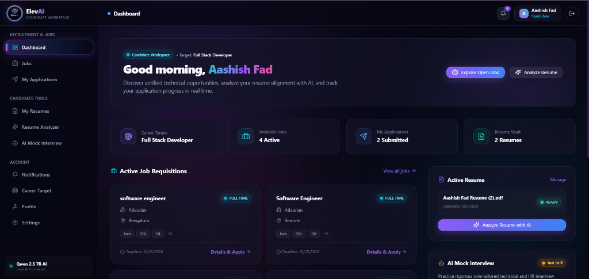
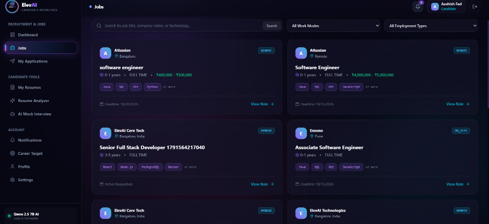
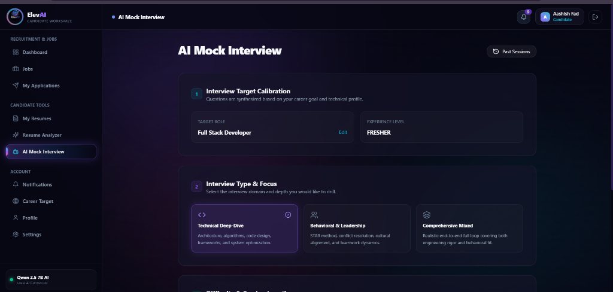
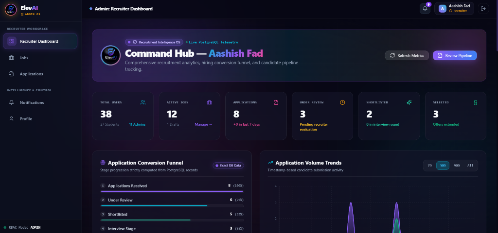
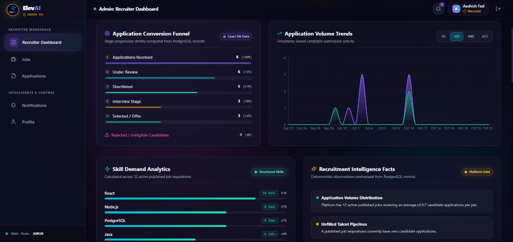
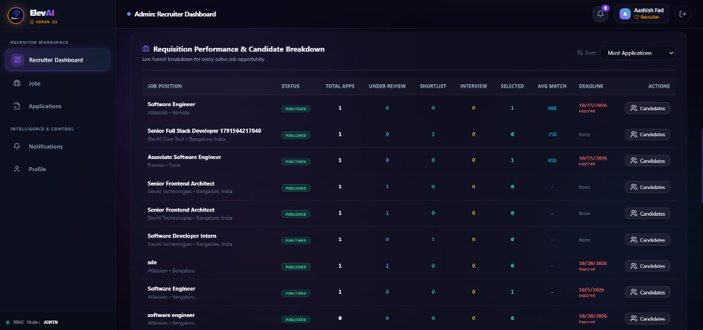
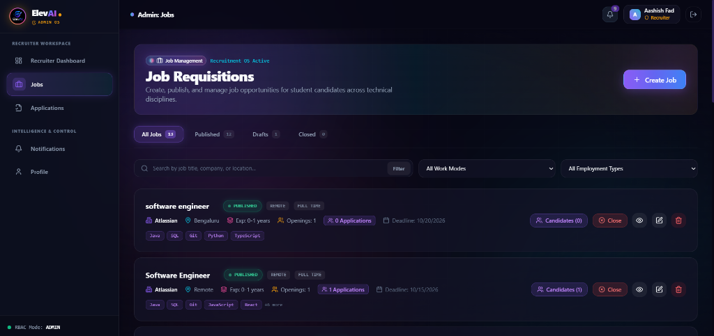
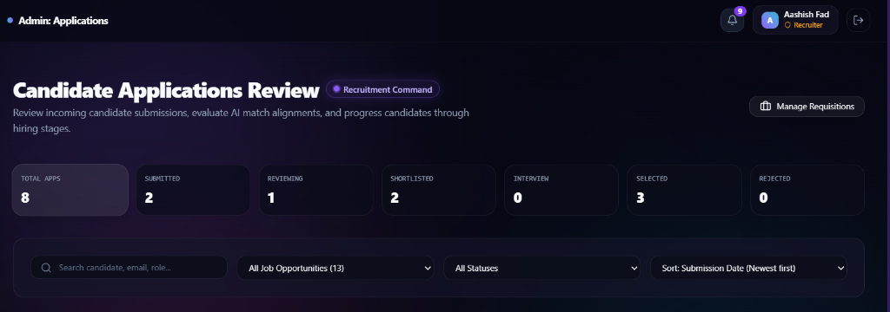

<div align="center">

  

  # ElevAI
  ### Intelligent Career Enablement & Recruitment Automation Platform

  [](https://react.dev/)
  [](https://vitejs.dev/)
  [](https://tailwindcss.com/)
  [](https://nodejs.org/)
  [](https://expressjs.com/)
  [](https://www.prisma.io/)
  [](https://supabase.com/)
  [](https://ollama.com/)
  [](LICENSE)

  <p align="center">
    <strong>ElevAI</strong> bridges the gap between job seekers and recruitment teams. Candidates get real-time AI resume analysis, ATS job match scoring, and interactive mock interviews; recruiters manage requisitions, review candidate dossiers with score snapshots, and drive hiring pipelines.
  </p>

  <p align="center">
    <a href="#-application-previews">Application Previews</a> •
    <a href="#-key-features">Key Features</a> •
    <a href="#-system-architecture">Architecture</a> •
    <a href="#-tech-stack">Tech Stack</a> •
    <a href="#-quick-start">Quick Start</a> •
    <a href="#-deployment-guide-render">Deployment</a> •
    <a href="#-api-reference">API Reference</a>
  </p>

</div>

---

## 📌 Overview

Traditional recruitment platforms suffer from two major disconnects:
1. **Candidates** submit static resumes into opaque Applicant Tracking Systems (ATS) without understanding skill gaps, match percentages, or how to prepare for interviews.
2. **Recruiters** are overwhelmed by unsifted applicants, lack structured match metrics, and rely on fragmented spreadsheets to track stages.

**ElevAI** solves this with an end-to-end, privacy-conscious recruitment platform featuring:
- **Local AI Engine**: Powered by **Ollama (`qwen2.5:7b`)**, executing all AI evaluations locally with zero cloud API token costs, low latency, and deterministic fallback calculations.
- **Dual Persona Workspaces**: Dedicated candidate and recruiter onboarding, portals, and role-based permissions.
- **Actionable ATS Scoring**: Deep multi-format resume parsing (`.pdf`, `.docx`) calculating matched skills, missing skills, and granular alignment scores.
- **Interactive Mock Interviewer**: Multi-turn technical and behavioral interview sessions with automated feedback and answer evaluations.
- **Complete Hiring Pipeline**: Single-click applications with resume snapshots, duplicate prevention, and real-time status synchronization.

---

## 📸 Application Previews

### 🎓 Candidate Experience

#### 1. Candidate Command Dashboard
The central hub for job seekers, featuring personalized greetings, target role benchmarks, active job recommendations, resume vault shortcuts, and one-click AI resume analysis.

<p align="center">
  
</p>

#### 2. Candidate Job Market Feed
Live job feed with multi-filter search (Work Mode, Employment Type, Technology keywords), compensation transparency, and direct role inspection.

<p align="center">
  
</p>

#### 3. AI Mock Interview Calibration
Interactive interview setup calibrated to the candidate's career goals and experience level. Supports **Technical Deep-Dive**, **Behavioral & Leadership**, and **Comprehensive Mixed** interview formats powered by local `qwen2.5:7b`.

<p align="center">
  
</p>

---

### 💼 Recruiter & Admin Workspace

#### 4. Recruiter Command Hub & Live Telemetry
Comprehensive recruitment analytics showcasing platform user counts, active jobs, application volume, candidate pipeline conversion funnels, and real-time PostgreSQL telemetry.

<p align="center">
  
</p>

#### 5. Conversion Funnel & Skill Demand Analytics
Real-time tracking of candidate stage progression (`Applications Received` $\to$ `Under Review` $\to$ `Shortlisted` $\to$ `Interview` $\to$ `Selected`) paired with structured skill demand rankings across active requisitions.

<p align="center">
  
</p>

#### 6. Requisition Performance & Candidate Breakdown
Granular requisition breakdown highlighting total applicants per job, stage-by-stage counts, average candidate ATS match percentages, and requisition deadlines.

<p align="center">
  
</p>

#### 7. Job Requisitions Management
Complete requisition lifecycle management: create, publish, filter by status (`Published`, `Drafts`, `Closed`), and view linked candidate applicant pools.

<p align="center">
  
</p>

#### 8. Candidate Applications Review Pipeline
Recruiter evaluation board for inspecting applicant dossiers, reviewing match scores, downloading resumes, and advancing candidates through hiring stages.

<p align="center">
  
</p>

---

## ✨ Key Features

### 🎓 Candidate Suite
- **Interactive Role Onboarding**: Two-step registration and login with explicit persona selection (Candidate vs Recruiter).
- **AI-Powered Resume Analysis**:
  - Secure document upload (`PDF`, `DOCX`) with automated text extraction.
  - Multi-dimensional scoring: ATS Compatibility Score, Job Alignment Score, Experience Fit, and Education Evaluation.
  - Skill breakdown: Extracted Skills, Matched Skills, and Missing Critical Competencies.
  - Actionable recommendations with bullet revisions.
- **Interactive AI Mock Interviewer**:
  - Practice Technical, HR/Behavioral, or Mixed interview rounds across Beginner, Intermediate, and Advanced difficulty levels.
  - Real-time scoring on technical accuracy, conceptual relevance, and communication clarity.
  - Review ideal sample answers, detailed reasoning, and performance history.
- **Job Feed & One-Click Application**:
  - Browse published positions with filters for Employment Type (`Full-time`, `Part-time`, `Contract`, `Internship`) and Work Mode (`Remote`, `Hybrid`, `Onsite`).
  - Submit applications instantly attaching a selected resume and computed match score.
  - Live tracking of application status: `SUBMITTED` $\to$ `UNDER_REVIEW` $\to$ `SHORTLISTED` $\to$ `INTERVIEW` $\to$ `SELECTED` / `REJECTED`.

### 💼 Recruiter Suite
- **Job Requisition Management**: Create, edit, publish, draft, or close job openings with detailed requirements and skill tags.
- **Candidate Dossier & Resume Viewer**:
  - Inspect candidate applications with pre-computed AI match scores and application dates.
  - Direct download and preview of candidate resumes from secure storage.
- **Evaluation & Stage Pipeline**:
  - Record private recruiter evaluation notes and internal ratings.
  - Update candidate stage in real time, notifying the applicant immediately.
- **Recruitment Analytics**: Track application counts, pipeline health, and top required competencies.

---

## 🏗️ System Architecture

```text
 ┌────────────────────────────────────────────────────────────────────────────────────────┐
 │                                   CLIENT (React 18 SPA)                                │
 │  ┌────────────────────────────────────────┐   ┌─────────────────────────────────────┐  │
 │  │        Candidate Dashboard & UI        │   │       Recruiter / Admin Panel       │  │
 │  │  • Job Feed & Search                   │   │  • Requisition Manager (CRUD)       │  │
 │  │  • AI Resume Analyzer (ATS Scoring)    │   │  • Candidate Dossiers & Resumes     │  │
 │  │  • Interactive Mock Interview Room     │   │  • Application Stage Transitions    │  │
 │  │  • Application Status Tracker          │   │  • Pipeline Analytics               │  │
 │  └────────────────────────────────────────┘   └─────────────────────────────────────┘  │
 └───────────────────────────────────────────────┬────────────────────────────────────────┘
                                                 │ HTTPS / REST (Axios + JWT Interceptors)
                                                 ▼
 ┌────────────────────────────────────────────────────────────────────────────────────────┐
 │                                   BACKEND (Node.js + Express)                          │
 │  ┌──────────────────────────────────────────────────────────────────────────────────┐  │
 │  │  Middleware: JWT Verification | Role-Based Access Control (RBAC) | Rate Limiter  │  │
 │  └──────────────────────────────────────────────────────────────────────────────────┘  │
 │                                               │                                        │
 │         ┌─────────────────────────────────────┼──────────────────────────────────┐     │
 │         ▼                                     ▼                                  ▼     │
 │  [ Business Controllers ]           [ Local AI Engine ]                  [ File Parser ]│
 │  • Auth & User Management           • Ollama Client (qwen2.5:7b)         • pdf-parse   │
 │  • Jobs & Applications Pipeline     • Structured Prompt Parsing          • mammoth     │
 │  • Mock Interview Evaluator         • Deterministic Fallback Matcher     • Multer      │
 │         │                                     │                                  │     │
 │         └─────────────────────────────────────┼──────────────────────────────────┘     │
 │                                               ▼                                        │
 │                                     Prisma ORM (v6) Engine                             │
 └───────────────────────────────────────────────┬────────────────────────────────────────┘
                                                 │
                               ┌─────────────────┴─────────────────┐
                               ▼                                   ▼
                ┌─────────────────────────────┐     ┌─────────────────────────────┐
                │     Supabase PostgreSQL     │     │      Supabase Storage       │
                │  (12 Relational Tables with │     │  (Private 'resumes' Bucket  │
                │   Enums, FKs & Indexing)    │     │   with Secure Download URLs)│
                └─────────────────────────────┘     └─────────────────────────────┘
```

---

## 💻 Tech Stack

| Domain | Technology | Description |
| :--- | :--- | :--- |
| **Frontend** | React 18 | Single Page Application framework with React Router v6 |
| | Vite 6 | Modern, lightning-fast frontend build tooling |
| | Tailwind CSS | Utility-first styling with custom dark-glass aesthetics |
| | Lucide React | Accessible, clean UI iconography |
| | React Hook Form | High-performance form state management and validation |
| **Backend** | Node.js (v18+) | Server-side JavaScript runtime |
| | Express.js 4 | Scalable REST API with modular routing and controllers |
| | Prisma ORM 6 | Type-safe database queries and automated migrations |
| | Supabase PostgreSQL | Managed relational database with strict foreign keys & enums |
| | Supabase Storage | Encrypted cloud object storage for candidate resumes |
| **Artificial Intelligence** | Ollama (`qwen2.5:7b`)| Local LLM providing fast, private, and deterministic evaluation |
| | Deterministic Scoring | Keyword & TF-IDF algorithmic fallback ensuring zero failures |
| **Security & Auth** | JSON Web Tokens (JWT)| Stateless authorization with role payload validation |
| | Bcrypt.js | Salted password hashing (10 rounds) |
| | RBAC Guards | Server-side role middleware distinguishing `USER` from `ADMIN` |

---

## 📂 Project Structure

```text
ElevAI/
├── client/                          # React Frontend Application
│   ├── public/                      # Static assets & logo
│   ├── src/
│   │   ├── components/              # UI, layout & modal components
│   │   ├── context/                 # AuthContext & global state
│   │   ├── hooks/                   # Custom hooks (useAuth)
│   │   ├── layouts/                 # RootLayout, DashboardLayout, AdminLayout
│   │   ├── pages/                   # Application views & admin pages
│   │   ├── services/                # Axios API client & endpoints
│   │   └── App.jsx                  # Application routing setup
│   └── package.json
│
├── server/                          # Node.js + Express Backend
│   ├── prisma/
│   │   └── schema.prisma            # Database schema definitions & enums
│   ├── src/
│   │   ├── ai/                      # Ollama & centralized AI engine
│   │   ├── config/                  # Database, environment & storage config
│   │   ├── controllers/             # Auth, Job, Resume, Admin controllers
│   │   ├── middleware/              # Auth, RBAC & error handlers
│   │   ├── routes/                  # Express API routers
│   │   ├── services/                # Business logic & database operations
│   │   └── app.js                   # Unified Express app (API + Static SPA)
│   └── package.json
│
├── docs/
│   └── assets/                      # Application preview screenshots
├── .env.example                     # Root environment template
├── .gitignore                       # Clean Git tracking configuration
├── render.yaml                      # Unified cloud deployment configuration
├── package.json                     # Monorepo build and start scripts
└── README.md                        # Master project documentation
```

---

## 🚀 Quick Start

### 1. Prerequisites
- **Node.js** (v18.x or higher) & **npm**
- **Git**
- **Ollama**: [Download Ollama](https://ollama.com/) for local AI inference.
- **Supabase Account** (or a local PostgreSQL instance).

### 2. Clone Repository
```bash
git clone https://github.com/your-username/ElevAI.git
cd ElevAI
```

### 3. Setup Local AI (Ollama)
ElevAI utilizes the open-weight `qwen2.5:7b` model for local resume intelligence and mock interviewing:
```bash
# Pull the target model (approx. 4.7 GB)
ollama pull qwen2.5:7b

# Ensure Ollama is running (default port: 11434)
ollama serve
```

### 4. Setup Backend Server
```bash
cd server

# Install dependencies
npm install

# Configure environment variables
cp .env.example .env
# Edit server/.env with your Supabase DB URL and JWT Secret

# Generate Prisma Client & Sync Database
npm run prisma:generate
npm run prisma:push

# Start Backend Development Server
npm run dev
# Server will run at http://localhost:5000
```

### 5. Setup Frontend Client
```bash
# Open a new terminal window
cd client

# Install dependencies
npm install

# Configure environment variables
cp .env.example .env
# Ensure VITE_API_BASE_URL="http://localhost:5000/api"

# Start Frontend Development Server
npm run dev
# Client will run at http://localhost:5173
```

---

## 🌐 Deployment Guide (Render)

ElevAI is pre-configured for **Single-Service Full-Stack Deployment**. A single web service builds the frontend and runs the backend, providing **one clean URL** (e.g. `https://elevai.onrender.com`) for both the web application and API.

### Render Dashboard Deployment Steps

1. Log in to [dashboard.render.com](https://dashboard.render.com) and click **New +** $\to$ **Web Service**.
2. Connect your **ElevAI** GitHub repository.
3. Configure the service settings:
   - **Name**: `elevai` *(or your custom name)*
   - **Runtime**: `Node`
   - **Branch**: `main`
   - **Build Command**: `npm run build`
   - **Start Command**: `npm start`
   - **Instance Type**: `Free`
4. Add the following **Environment Variables**:

| Variable | Recommended Value | Source |
| :--- | :--- | :--- |
| `NODE_ENV` | `production` | Literal |
| `PORT` | `10000` | Literal |
| `DATABASE_URL` | `postgresql://...` | Supabase Dashboard $\to$ Settings $\to$ Database (Pooled) |
| `DIRECT_URL` | `postgresql://...` | Supabase Dashboard $\to$ Settings $\to$ Database (Direct) |
| `JWT_SECRET` | *(Random 32+ character string)* | Security secret |
| `SUPABASE_URL` | `https://[REF].supabase.co` | Supabase Dashboard $\to$ Settings $\to$ API |
| `SUPABASE_SERVICE_ROLE_KEY` | `eyJ...` | Supabase Dashboard $\to$ Settings $\to$ API (`service_role`) |
| `MAX_FILE_SIZE_MB` | `5` | Literal |

5. Click **Deploy Web Service**. Render will build the client, initialize Prisma, and host your entire application under a single live link!

---

## 📡 API Reference

### Authentication (`/api/auth`)
- `POST /register`: Register a new user with persona selection (`USER` for Candidate, `ADMIN` for Recruiter).
- `POST /login`: Authenticate credentials with optional role persona guard.
- `GET /me`: Retrieve the currently authenticated profile from JWT.

### Jobs & Requisitions (`/api/jobs`)
- `GET /`: Retrieve published jobs with search, category, and work-mode filters.
- `GET /:id`: Retrieve detailed job description, required skills, and deadlines.

### Resumes & AI Analysis (`/api/resumes` & `/api/analysis`)
- `POST /resumes/upload`: Upload PDF or DOCX file to Supabase Storage and parse raw text.
- `GET /resumes`: List all resumes uploaded by the authenticated candidate.
- `POST /analysis/analyze`: Trigger AI resume scoring against selected job description (ATS score, matched/missing skills).
- `GET /analysis/history`: View past resume analysis results.

### Job Applications (`/api/applications`)
- `POST /`: Submit application for a job with attached resume and computed match score snapshot.
- `GET /my`: List all applications submitted by the current candidate.
- `GET /:id`: View status and timeline of a specific application.

### Mock Interview Room (`/api/interview`)
- `POST /start`: Initiate a new mock interview session with specified role, type, and difficulty.
- `POST /:id/answer`: Submit answer to the active question and receive instant evaluation and score breakdown.
- `GET /history`: Review completed mock interview transcripts and scores.

### Recruiter & Admin Control (`/api/admin`)
- `GET /jobs`: List all managed jobs (including drafts and closed requisitions).
- `POST /jobs`: Create and publish a new job requisition.
- `PUT /jobs/:id`: Update job details or change status (`DRAFT`, `PUBLISHED`, `CLOSED`).
- `GET /applications`: Inspect submitted candidate dossiers across all jobs.
- `PATCH /applications/:id/status`: Update candidate hiring status (`SUBMITTED`, `UNDER_REVIEW`, `SHORTLISTED`, `INTERVIEW`, `SELECTED`, `REJECTED`).
- `POST /applications/:id/notes`: Add private recruiter evaluation notes.

---

## 🛡️ Security & Privacy

1. **Role-Based Access Control (RBAC)**: All administrative endpoints are guarded by `roleMiddleware(['ADMIN'])`. Candidates attempting to access recruiter controls receive immediate `403 Forbidden` responses.
2. **Local AI Privacy**: Resume texts and interview answers are processed locally on your machine via Ollama. No proprietary candidate data is sent to external commercial AI APIs.
3. **Password Security**: Passwords are encrypted using `bcryptjs` with salt rounds before database persistence.
4. **Secure Storage**: Uploaded resume files reside in private storage buckets accessible only via signed tokens or backend service role credentials.

---

## 📄 License

This project is licensed under the [MIT License](LICENSE).

---

<div align="center">
  <sub>Built with ❤️ for intelligent, transparent, and fair recruitment.</sub>
</div>
